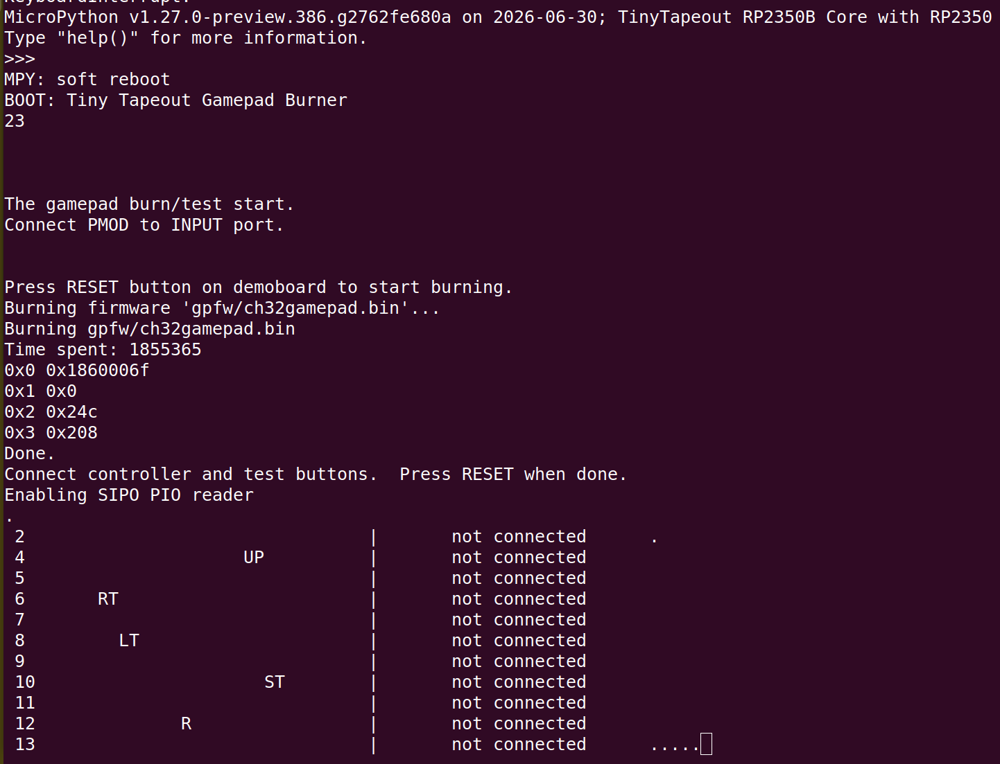

# gamepad-update
Update gamepad CH32V from demoboard

This code allows you to burn firmware to the gamepad PMOD directly from the TT demoboard.  

Just set the jumper (between SWDIO and PRJ at the top of the connector) and run code as in [./src/main.py](main.py).

To make things really easy, if you have a TT Demoboard (ETR v3.2), there's a [./rp2fw/tt-gamepadprog-rp2350-3.0.7GP.uf2](UF2 image) that you can write to the RP2350 and it will provide a little interface to burn the latest firmware and test the controller

